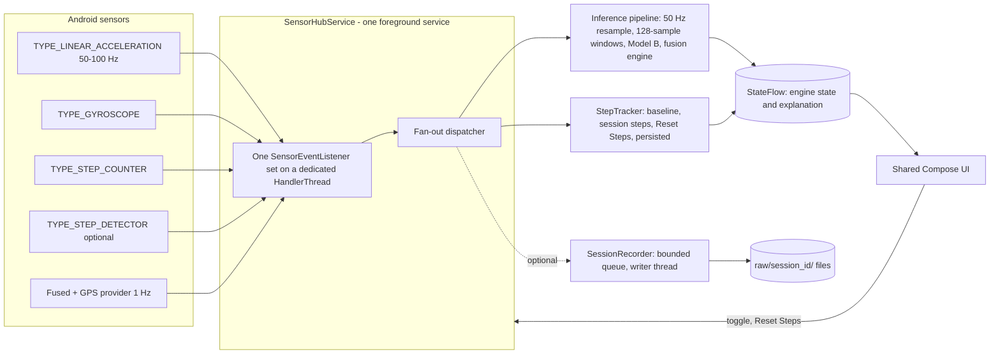

# Kinesis Logger Audit and App B Integration Plan

Status: AUDIT ONLY. Written on branch `logger-audit` of the main repo. **Nothing was built into the main repo, no logger source was modified, no ML model, fusion threshold or earlier-phase result was touched, and live evaluation is still NOT PERFORMED. No live results exist.** Awaiting user approval before any Android work.

Evidence labels: **Verified** = read in code, config, screenshot or by a command run during this audit. **Inferred** = reasoned from Android API behaviour or from the code without running it. **Device** = cannot be settled without a physical phone.

---

## 1. Executive summary

The existing `kinesis-logger` is a real, working Kotlin/Compose research logger. It has a foreground service, a bounded-queue writer thread, task cards, pre-flight, crash flagging, quality summary, SHA-256 manifest, zip export and an S3 upload queue. It built and its 13 unit tests passed in a temporary copy (Section 2.4). A real session from an OPPO CPH2213 (Android 13) is visible in the owner's screenshots, so the base has been field-tested once.

It is **not yet compatible with the Phase 4 fusion pipeline**, for three reasons that matter most:

1. **Wrong accelerometer stream for Model B (Bug vs the Phase 4 protocol).** It logs `TYPE_ACCELEROMETER` (gravity included) to `accel.csv.gz`. `ingest_live_logs.py` reads `linear_accel.csv[.gz]` and rejects any session whose median magnitude is over 5 m/s^2. Logger Spec v0.1 itself lists a raw `accel` stream, so the logger meets the spec, and the Phase 4 protocol adds `linear_accel` as a documented extension.
2. **`session.json` shape and field names differ.** The logger writes nested groups (`identity`, `device`, `time`, ...) and a `ground_truth` object. The ingest script requires flat keys (`device_model`, `boot_offset_ms`, `split`, `scenario`, ...) and a string `ground_truth`. A fixture run confirmed the current shape is rejected (Section 7.2).
3. **No Phase 4 scenario metadata.** No `split`, `scenario` (S1-S7), `operator_start_utc_ms`, `operator_end_utc_ms`, `mock_app_name`, `gps_provider`. The location `provider` value is `gps_provider`, but the ingest default is `gps`.

Other significant findings: no Android developer-options mock-app detection (only per-fix `is_mock`); service uses `START_NOT_STICKY`; finalisation (gzip, hashing, session.json) runs on the main thread; the writer thread has no exception handling; `session.json` is written only at the end (a crashed session has none); no per-sensor metadata; several hard-coded values (battery start 80, `has_step_counter` true, `install_id` random per session); the GPS fix-percentage is overstated because two location streams share one file.

**Recommendation.** Treat the logger as a reference implementation and port its logic into App B's shared sensor service as a `SessionRecorder` module, with the changes in Section 9. Change the logger's output to match the schema (not the frozen fusion engine). Logging becomes an optional "Evaluation recording" mode in App B, not a third app. Because the logger is owned by another GitHub account and has **no licence file**, get written permission or a collaborator/fork arrangement from Sriharsh297 before copying code (Section 2.3).

**Decisions needed from you** are listed in Section 16.

---

## 2. Repositories and git state

### 2.1 State

| Item | Main repo | Logger repo |
| --- | --- | --- |
| Path | `e:\My_Projects\Major Project` | `e:\My_Projects\Major Project\Kinesis - data` |
| Remote (Verified) | `origin` = `https://github.com/psamuelvijay/Kinesis.git` | `origin` = `https://github.com/Sriharsh297/kinesis-logger.git` |
| Branch (Verified) | `logger-audit` (HEAD `ca83ea4`), plus `main`, `phase2/3/4` branches | `main` only; HEAD `51b9d6e`; equals local `origin/main` ref (no fetch was run) |
| Authors (Verified) | n/a | one commit author: Arikela Sriharsh |
| Uncommitted | `M docs/Kinesis_Literature_Survey.pdf`; untracked `.agents/`, `datasets/dryad/processed/phase3_modelA_sensitivity/`, `results/metrics/phase3_gates/`, several `.pptx`, the spec copy in `docs/`, and scratch `results/logger_audit_tmp/` | 4 tracked screenshots deleted in the working tree (`01_dashboard.png`, `03_preflight.png`, `04_preflight_bottom.png`, `08_recording_hud.png`); 6 untracked screenshots. Same 10 entries before and after this audit |
| Separation (Verified) | `.gitignore` contains `Kinesis - data/`, so the main repo cannot track or commit logger files | has its own `.git` |

`local.properties` in the logger holds only an Android SDK path (value not reproduced). It is git-ignored in the logger (`.gitignore:14`). No keystore or key files are tracked. Raw data (`*.csv`, `*.csv.gz`, `*.zip`, `raw/`) is git-ignored. No recording or `session.json` exists anywhere under the logger or main repo on this machine (Verified by file search), so **no real-data compatibility check was possible**.

### 2.2 Spec copy differences (Verified, `diff`)

The logger's tracked spec and the user's untracked copy in `docs/` differ **only in Section 9 (Full collection plan)**:

- Logger copy: table "Phase 1 target / Extended" (GENUINE 20 h / 32 h, BENIGN 6 h / 9 h, FRAUD 8 h / 14 h, total about 34 h / 55 h) plus a paragraph that targets are cumulative bout time (about 150 bouts for 20 h genuine).
- `docs/` copy: per-type table (G1 20, G2 4, G3 2, G4 3, G5 3 = 32 h; B1-B4 = 9 h; F1-F7 = 13 h; F8 1 h; about 55 h) and no paragraph.

Sections 0-8 and 10-13 (all logger-relevant sections: streams, time base, metadata, app functionality, pilot gates) are identical. The `docs/` copy is the reference per your instruction.

### 2.3 Licence and ownership

- **Licence: none found.** No `LICENSE*` file at the logger root or among tracked files, and the README has no licence statement (Verified locally; the GitHub page itself was not checked). Without a licence, default copyright applies: nobody else may copy, modify or redistribute the code without the owner's permission.
- The README, handover and docs show Sriharsh297 as an author of the project and the Logger Spec is addressed to "P Samuel Vijay and A Sriharsh", so both are collaborators on the research, but this is not a licence grant (Inferred).
- **Recommendation (not an action):**
  1. Ask Sriharsh297 to add a licence (MIT or Apache-2.0) or a written statement permitting reuse in the Kinesis project. This is the cleanest option.
  2. Preferred workflow: Sriharsh297 adds psamuelvijay as a collaborator, or you fork `kinesis-logger`. Do logger fixes on a feature branch of the fork and open a PR to the owner. Keeps history and credit.
  3. For App B, either depend on the logger as a git submodule or published module, or re-implement behind the interfaces in Section 10, referencing the logger. Vendoring (copying files) only after (1).
  4. Never commit logger source into the main repo before (1). This audit quotes only short snippets with file:line references.

### 2.4 Build check (Verified)

JDK 21 and an Android SDK (platforms 35, 36) exist. A copy of the logger, without `.git`, `.gradle`, `build`, `.idea`, `.kotlin` and screenshots, was made in `results/logger_audit_tmp/build_copy/` and built with `gradlew --offline testDebugUnitTest assembleDebug --rerun-tasks`.

- `BUILD SUCCESSFUL`; debug APK about 58.7 MB.
- 13 unit tests, 7 classes, 0 failures (`CrashRecoveryTest` 1, `QualityCalculatorTest` 1, `RecordingStateTest` 3, `SessionJsonBuilderTest` 1, `SessionWriterTest` 3, `TaskLoadingTest` 1, `UploadValidationTest` 3).
- `lintDebug` could not run: `lint-gradle:31.13.2` is not in the offline Gradle cache. Lint is **not performed**.
- The instrumented test was not run (no device). The logger working tree was unchanged afterwards (same 10 status entries).

---

## 3. Toolchain and architecture (Verified)

| Item | Value | Source |
| --- | --- | --- |
| Language / UI | Kotlin 2.0.21, Jetpack Compose (BOM 2024.11.00), Material 3, Navigation Compose 2.8.4 | `gradle/libs.versions.toml`, `app/build.gradle.kts:42-55` |
| SDK levels | minSdk 29, targetSdk 35, compileSdk 35 | `app/build.gradle.kts:9-14` |
| AGP / Gradle / JDK target | AGP 8.13.2, Gradle 8.13, Java 17 | `libs.versions.toml`, `gradle-wrapper.properties`, `build.gradle.kts:30-36` |
| Location | `play-services-location` 21.3.0 plus platform `LocationManager` | `libs.versions.toml` |
| DI / persistence | none (companion-object singletons, `SharedPreferences` for crash flag) | `RecordingService.kt:84`, `CrashRecoveryManager.kt:9` |
| Modules | single `app` module | `settings.gradle.kts` |
| Packages | `recorder` (SensorRecorder, SessionWriter, samples), `service` (RecordingService, CrashRecoveryManager, state), `quality` (finalizer, JSON, manifest, exporter, calculator), `upload` (S3), `ui/*`, `data`, `model` | tree |
| Tests | 13 JVM unit tests; 1 instrumented test | Section 2.4 |

Architecture: UI -> `RecordingService.start()` intent -> service creates `SessionWriter` and `SensorRecorder` (`RecordingService.kt:215-217`), runs the protocol sequence in a coroutine on `Dispatchers.Main` (`:46`, `:246`), and exposes a global `StateFlow` HUD (`:81`). The post-session screen calls `SessionFinalizer.finalizeSession` again with operator inputs (`PostSessionScreen.kt:419`).

Code quality: readable, consistently named, commented against the spec. Weaknesses: global mutable singletons (`RecordingService.instance`, static `_hudState`), no ViewModels, no interfaces between recorder and writer (hard to reuse as a fan-out sink), `e.printStackTrace()` as error handling, mojibake in comments/strings (`—`, `µs` in the manifest comment and Pre-flight text, Verified in the file), hard-coded values (below), tests that are partly simulated (Section 6).

**UI note (Verified from screenshots):** the logger UI is a dark navy theme with cyan/blue gradient buttons and a "KINESIS LOGGER" wordmark. That is a "fitness-tech" look and does not match the restrained Material 3 palette required for Apps A and B. Do not reuse the theme (Section 14).

---

## 4. Spec-compliance audit (Logger Spec v0.1)

Verdicts: Compliant / Partial / Missing / Bug / Unverifiable-without-device (UWD).

### 4.1 Ten required items

| # | Item | Evidence | Verdict |
| --- | --- | --- | --- |
| 1 | **Accelerometer** | `SensorRecorder.kt:34` `getDefaultSensor(TYPE_ACCELEROMETER)`; logged raw at `:151-160`. `TYPE_LINEAR_ACCELERATION` appears nowhere in `app/src` (grep). Requested period 10,000 us (`:79`, `:82`) via `registerListener(listener, sensor, samplingPeriodUs)`; no max-report-latency argument, so batching is not requested (default 0). Default (non-wake-up) sensor. Listener has no Handler, so callbacks arrive on the main thread (Inferred from AOSP default). Achieved rate is only shown live in the HUD (screenshot: 94.4 Hz on OPPO CPH2213); the achieved rate lands in `session.json` as `achieved_rate_median` | **Compliant with Spec v0.1** (raw `accel`, 100 Hz request). **Missing** for Phase 4: `linear_accel` stream. Achieved 94.4 Hz (<100) = UWD per device |
| 2 | **Gyroscope** | `:35` `TYPE_GYROSCOPE` (calibrated, not `_UNCALIBRATED`), logged at `:162-171`, same rate/handler/batching as accel | **Compliant** (calibrated gyro is what Model B needs) |
| 3 | **Physical step counter** | `:36-37` both `TYPE_STEP_DETECTOR` (`SENSOR_DELAY_FASTEST`, `:87-89`) and `TYPE_STEP_COUNTER` (`SENSOR_DELAY_UI`, `:90-92`); cumulative `float -> Long` at `:178`; logs every delivered value (`step_counter.csv: t_ns,cumulative`). `ACTIVITY_RECOGNITION` declared (`AndroidManifest.xml:9`) and requested at runtime (`MainActivity.kt:74-76`, Pre-flight blocks Start without it, `PreFlightScreen.kt:187`). The first delivered value is written, which is the baseline the Phase 4 protocol asks for. No reboot handling (a decrease is not flagged; `QualityCalculator.kt:239` subtracts last-first). Units: steps (count) | **Compliant** for raw logging. **Partial**: no reboot/decrease detection, delta ignores a baseline taken before the first event, step-counter not required to be present for Start, but Pre-flight blocks Start without `ACTIVITY_RECOGNITION` even on a phone with no step sensor |
| 4 | **GPS** | `LocationRequest.Builder(PRIORITY_HIGH_ACCURACY, 1000)` fused (`:95-100`) plus `GPS_PROVIDER` at 1000 ms/0 m (`:105-115`), both on the main Looper. Columns `lat, lon, alt, accuracy, speed, speed_acc, bearing, bearing_acc` (`:223-237`, header `SessionWriter.kt:80`). `speed_acc`/`bearing_acc` written as `-1` when unavailable (`:206-216`). Vertical accuracy is not logged (Spec §5 does not list it). Provider is the literal `fused` or `gps_provider`, ignoring `location.provider` (`:56`, `:242`). Screenshot `location.png` shows both streams at about 1 Hz each | **Compliant** with Spec §5. Notes: fused rows in the sample show `alt` constant 450.70001220703125, `speed` 0.0 and `bearing` 0.0 (looks like fused placeholders, Inferred); GPS-provider rows have real values. Ingest needs provider `gps` |
| 5 | **Mock detection** | Per fix: `Location.isMock` on API 31+, `isFromMockProvider` below (`:199-204`), written 0/1 (`is_mock`). Pre-flight only shows guidance and states it "does not detect active mock locations" (`PreFlightScreen.kt:399-403`); `isMockExpected` is just `labelType == F6/F7` (`:183`). Summary stat `mock_flag_pct` (`QualityCalculator.kt:208`) | **Partial.** Per-fix flag Compliant; Developer-options / mock-app detection **Missing**; `mock_app_name` never recorded. It is correctly only an indicator, never the label. Behaviour of `isMock` on fused vs GPS provider with real mock apps = UWD |
| 6 | **Timestamp consistency** | `event.timestamp` (`:148`) and `location.elapsedRealtimeNanos` (`:195`) written unchanged as `t_ns`; no per-row wall clock except `utc_ms = location.time` (`:196`, in Spec §5 columns). `start_utc_ms`, `start_elapsed_ns`, `boot_offset_ms = startUtc - startElapsed/1e6` once per session (`:65-67`), also in an event note (`:70-76`). Two clocks are sampled by two calls, so the offset has about millisecond error and no drift tracking. Screenshot sample: `utc_ms - t_ns/1e6` is 1,794,370,477,886-887 for fused rows (consistent), but one `gps_provider` row differs by about 837 ms (Verified from the screenshot text) | **Compliant** in design. Same-clock claim for sensors vs location = **UWD** (Spec says verify on every pilot phone). `utc_ms` on GPS-provider rows is not reliable for conversion; use `t_ns` + boot offset. Crash recovery writes `System.nanoTime()` (`CrashRecoveryManager.kt:45`) = wrong clock, **Bug** (minor) |
| 7 | **Units** | Raw `event.values` copied with no scaling (`:151-171`). Android gives accel m/s^2 and gyro rad/s, so no conversion bug. Accel includes gravity because it is `TYPE_ACCELEROMETER` (`docs/DATA_DICTIONARY.md:34` states this) | **Compliant** for what is logged. For Model B, gravity-free linear acceleration is **Missing** |
| 8 | **Background / screen-off** | Foreground service with `foregroundServiceType="location|health"` (`AndroidManifest.xml:43-46`, `RecordingService.kt:226-231`), `PARTIAL_WAKE_LOCK` acquired for 12 h (`:157`, `:221-223`), ongoing low-importance notification (`:455-486`), screen on/off events (`:129-142`), battery-optimisation hint in Pre-flight (`PreFlightScreen.kt:411-418`) with `REQUEST_IGNORE_BATTERY_OPTIMIZATIONS`. `START_NOT_STICKY` (`:197`) so a killed service does not restart. No `onTaskRemoved`. `HIGH_SAMPLING_RATE_SENSORS` declared (not needed at 100 Hz; Android 12+ cap is 200 Hz). The instrumented "10-minute screen-off" test only feeds fake samples to the writer; it does not exercise sensors or the screen | **Partial.** Mechanism present and plausible. 10-min screen-off sample retention, OEM kill behaviour, step-counter delivery with screen off, Android 14/15 FGS start rules = **UWD**. Restart-after-kill **Missing** (by design for a research logger, but the spec wants recovery flagged, which exists) |
| 9 | **Session lifecycle** | Start: ID, dirs, writer, recorder, wake lock, FGS (`:200-244`). Stop: early stop only before the bout or by moving to final stillness (`:368-383`); hold-to-stop UI present. Finalise: `stopRecording` + `stopAndClose` (`:385-409`), gzip + verify + delete raw CSV (`SessionFinalizer.kt:47-65`), quality, manifest, `session.json` (`:99`), manifest again (`:103`). Reset: none (no concept). Crash: SharedPreferences flag, on next launch appends an `interruption` event and writes `interrupted.flag` (`CrashRecoveryManager.kt:33-66`). Flush every 1 s (`SessionWriter.kt:212`) but no `fsync`. `session.json` and `manifest.sha256` are written with plain `writeText` (not atomic). Manifest is `<sha256>  <name>` per file (`ManifestGenerator.kt:23`), sorted | **Partial.** Core flow Compliant. Gaps: `session.json` written only at the end (Spec §4 says at start and completed at end), interrupted sessions have no `session.json`/`manifest.sha256`, finalisation on main thread, no atomic writes/fsync, double finalisation (service then post-session screen) rewrites files. Discard deletes all files (`PostSessionScreen.kt:456-461`) |
| 10 | **Output vs `ingest_live_logs.py` and Spec §5** | See Sections 6 and 7 | **Partial** (Spec §5 layout Compliant, Phase 4 ingest **not compatible** as-is) |

### 4.2 Extra spec requirements

| Requirement | Evidence | Verdict |
| --- | --- | --- |
| Pre-flight: sensors, rates, GPS, battery > 30 %, storage, step sensors, battery-optimisation, mock status | `PreFlightScreen.kt:149-190,344-418` | **Partial.** Rates not measured (text only), "requested vs achieved" absent, mock status not detected |
| Block Start on missing accel/gyro or storage < 500 MB | `:186-188` | Compliant (also blocks on missing permissions) |
| Writer thread, bounded queues, no UI-thread file I/O, dropped counters | `SessionWriter.kt:20-25,96-148`, thread `:88` | Compliant for samples. **Bug**: finalisation I/O on main (below). Drop counters exist but are not written to `session.json` (only counts) |
| Flush at least every second | `:212` | Compliant (OS cache only) |
| Crash safety: readable up to last 2 s, flagged next launch | `CrashRecoveryManager`, 1 s flush | Compliant in design; **UWD** (kill test) |
| Gzip on save and verify | `SessionFinalizer.kt:47-65`, `SessionWriter.kt:271-317` | Compliant. Only accel and gyro are gzipped, as in Spec §5 layout |
| Task cards from `assets/tasks.json` | 16 tasks (`TaskRepository.kt`) | Compliant. Cards cover T01-T16 of the data-collection protocol, **not** the Phase 4 scenarios S1-S7 |
| Countdown 10 s, still 5 s, bout, still 5 s, vibration, events | `RecordingService.kt:246-366` | Compliant. Events `countdown_end`, `still_start/end`, `bout_start/end`, `tap_start/stop`, `screen_on/off`, `user_marker`, `permission_change`, `interruption` present; `service_restart` never emitted |
| session.json: all Spec §4 fields, null where unknown | `SessionJsonBuilder.kt` | **Partial.** Missing: per-sensor name/vendor/range/resolution/min_delay_us/requested+achieved rate; `build_hash` is `"git-main"` (`:43`); `has_step_counter`/`has_step_detector` hard-coded true (`:56-57`); `gnss_raw_supported` hard-coded false; `install_id` random per session (`SessionFinalizer.kt:95`, spec wants one per install); `battery_start_pct` hard-coded 80 (`:93`); `app_restarts` hard-coded 0 (`:141`); `walk_group_id`, `carried_with`, `route_id`, `footwear`, `rig_id`, `mock_app_name`, `mock_route_id`, `operator_note` always null; no `dropped_*` counters |
| Session ID `KIN-YYYYMMDD-Sxx-nn` + UUID | `RecordingService.kt:205-208` gives `KIN-yyyyMMdd-HHmmss-S01-T01-xxxxxx` (screenshot `objects.png` agrees) | **Partial** (different but unique, usable) |
| No internet permission in v0 | `AndroidManifest.xml:5-6` INTERNET; `upload/S3Uploader.kt` presign + PUT to a hard-coded API Gateway URL (`:37-38`) | **Deviation**, consistent with Spec v0.5 upload queue. Must be removed or disabled in App B |
| Quality fields (rate, p99 gap, gaps > 100 ms, GPS fix %, OS step delta, mock %, screen-off) | `QualityCalculator.kt` | **Partial.** GPS fix % counts rows over duration, fused + provider rows doubly count and `coerceIn(0,100)` hides it (`:194-196`), **Bug**. Gyro rate/gaps computed but not written (only accel in `session.json`, `SessionJsonBuilder.kt:130-132`). Location duration uses all rows |
| Sessions list, zip export | `SessionExporter.kt` (zip with plain `ZipOutputStream`, FileProvider) | Compliant |
| Hold 2 s to stop | `KinesisHoldToStopButton` (`RecordingScreen.kt:58,399`); HUD screenshot shows "HOLD 2s TO STOP BOUT" | Compliant (Verified from screenshot) |

---

## 5. Bugs, race conditions and risks

Severity: **H** = can lose or corrupt data or break the pipeline; **M** = wrong metadata or fragile behaviour; **L** = cosmetic or minor.

| ID | Sev | Finding | Evidence | Status |
| --- | --- | --- | --- | --- |
| B1 | H | Only gravity-included `accel` is logged; Phase 4 needs `linear_accel`. Ingest rejects the session | `SensorRecorder.kt:34`; `ingest_live_logs.py:129,144-146` | Verified |
| B2 | H | Writer thread has no try/catch around writes. A single `IOException` (disk full, storage removed) ends the thread silently; samples then pile up in the queues, are dropped and counted, and `flushAll` swallows IO errors | `SessionWriter.kt:150-226,243-245` | Inferred |
| B3 | H | Finalisation (gzip of up to tens of MB, SHA-256, JSON) runs inside a coroutine on `Dispatchers.Main`; `stopAndClose` also `join(3000)` on main. ANR risk on long sessions/slow storage | `RecordingService.kt:46,248,358,385-409`; `SessionWriter.kt:248-254` | Verified (code); ANR = Device |
| B4 | H | `session.json` exists only after finalisation. A killed session has CSVs and `interrupted.flag` only, with no device, time or boot-offset metadata, so it cannot be converted to the elapsed clock | `CrashRecoveryManager.kt:33-66`; `SessionFinalizer.kt:99` | Verified |
| B5 | M | `session.json`/`manifest.sha256` not atomic (`writeText`); a kill during finalisation can leave a truncated file. No `fsync` anywhere | `SessionFinalizer.kt:99`; `ManifestGenerator.kt:26` | Verified |
| B6 | M | Listeners are registered without a Handler, so sensor callbacks run on the main thread (Inferred AOSP behaviour). UI work or the finalisation above can delay delivery and the sensor HAL queue may overflow | `SensorRecorder.kt:81-92` | Inferred; Device |
| B7 | M | Requested 100 Hz, HUD shows 94.4 Hz on the test phone. Rate is a request; no check of `Sensor.getMinDelay`, no achieved-rate gate in Pre-flight, gyro rate not stored | screenshot (HUD); `SensorRecorder.kt:79` | Verified (screenshot); Device |
| B8 | M | Back-pressure policy is "drop newest, count" per stream; queue 10,000 for accel/gyro (about 100 s at 100 Hz), 1,000 for others. Counts are not exposed in `session.json` | `SessionWriter.kt:18-25,96-103` | Verified |
| B9 | M | `START_NOT_STICKY` and no `onTaskRemoved`: if the service is killed (OEM manager, swipe), recording stops; the next launch only flags it. `service_restart` event and `app_restarts` are never produced | `RecordingService.kt:197`; `JsonBuilder:141` | Verified |
| B10 | M | Pre-flight does not detect mock-location app selection; cannot check the S1-S4 "mock is off" rule from the Phase 4 protocol | `PreFlightScreen.kt:399-403` | Verified |
| B11 | M | `has_step_counter` hard-coded `true`. On a phone without the sensor, ingest would then demand `step_counter.csv` | `SessionJsonBuilder.kt:56-57`; `ingest_live_logs.py:131` | Verified |
| B12 | M | GPS fix % overstated (two providers), p99 gap fine. Step delta = last - first, so steps before the first delivered value are lost and a reboot (counter reset) would give a negative or wrong value | `QualityCalculator.kt:194-196,239` | Verified |
| B13 | M | `provider` written as `gps_provider`/`fused`; ingest default is `gps` | `SensorRecorder.kt:56,242`; `ingest_live_logs.py:152` | Verified |
| B14 | M | `ground_truth` in `session.json` is an object (`bout_type`, `manual_step_count`, `count_method`) but ingest expects a string `walking | physically_stationary | other` | `SessionJsonBuilder.kt:107-112`; `ingest_live_logs.py:117` | Verified |
| B15 | L | Interruption event uses `System.nanoTime()` not `elapsedRealtimeNanos` | `CrashRecoveryManager.kt:45` | Verified |
| B16 | L | Float values written with `toString` (e.g. `9.097274E-4` visible in `location.png`); pandas parses it, but column text is not fixed-precision | `SessionWriter.kt:160`; screenshot | Verified |
| B17 | L | Gzip uses default compression on the whole file after the session (extra CPU/IO at the end; temporary 2x disk) | `SessionFinalizer.kt:47-65` | Verified |
| B18 | L | `registerReceiver` for screen events without export flag; acceptable for protected system broadcasts, but verify on targetSdk 35 | `RecordingService.kt:178` | Inferred |
| B19 | L | `allowBackup="true"` with an empty `<full-backup-content>`; raw data lives in external app files, so confirm cloud backup excludes it | `AndroidManifest.xml:23`; `backup_rules.xml` | Inferred |
| B20 | M | Hard-coded upload endpoint and cloud bucket name appear in source/screenshot; not a secret key, but a deployment coupling and a privacy surface for GPS data | `S3Uploader.kt:37-38`; `objects.png` | Verified |
| B21 | L | `registerListener(..., SENSOR_DELAY_UI)` for step counter, no wake-up variant or batch latency; step-counter/detector delivery with screen off on aggressive OEMs unknown | `SensorRecorder.kt:90-92` | Device |
| B22 | L | Battery/thermal: 100 Hz x2 sensors + two location requests + 12 h wake lock; no battery-drain figure recorded other than the two battery fields (start is a constant) | `SessionFinalizer.kt:93` | Device |
| B23 | M | Pre-flight blocks Start without `ACTIVITY_RECOGNITION`; fine for the logger, but App A must not request it (Phase 4 plan 12.4) | `PreFlightScreen.kt:187` | Verified |

**Sensor processing:** no filtering, scaling, resampling or smoothing of sensor values anywhere (Verified, `SensorRecorder.kt:144-186`). Raw logging principle is met. The only "processing" is `float -> Long` for the step counter and `-1` placeholders for unavailable accuracy fields.

**Scoped storage:** files go to `getExternalFilesDir(null)/raw/<id>` (app-specific), so no storage permission is needed on API 29+. They are deleted on uninstall and not visible to other apps. Export is via FileProvider zip (Verified `RecordingService.kt:210-212`, `SessionExporter.kt`).

---

## 6. Test coverage (Verified)

Unit tests cover writer files, session JSON keys, quality calculator (one case), crash flag, state enum, task loading and upload validation. They do **not** cover: sensor registration, `isMock` branches, clock alignment, the service lifecycle, finalisation on a large file, or any ingest compatibility. The instrumented test feeds 60,000 synthetic samples to `SessionWriter` and calls it a screen-off test (`LongScreenOffRecordingTest.kt:25-66`); this verifies writer throughput only, not Spec gate "10 min screen off keeps >= 99 % of samples".

---

## 7. Format compatibility with `ingest_live_logs.py`

### 7.1 Field-by-field (Verified from both code bases)

| Ingest requires | Logger writes | Result |
| --- | --- | --- |
| `linear_accel.csv[.gz]`, cols `t_ns,x,y,z` (`:58,129`) | `accel.csv.gz` (`t_ns,x,y,z,accuracy`), gravity included | **Fail.** File missing; if renamed, rejected by the > 5 m/s^2 check (`:144-146`) |
| `gyro.csv[.gz]` `t_ns,x,y,z` | `gyro.csv.gz` same columns | Pass |
| `step_counter.csv` `t_ns,cumulative` | same | Pass |
| `step_detector.csv` optional | same | Pass |
| `location.csv` `t_ns,utc_ms,provider,lat,lon,accuracy,speed,is_mock` | all present plus `alt, speed_acc, bearing, bearing_acc` | Pass on columns |
| rows with `provider == meta.gps_provider` (default `gps`) | `gps_provider` and `fused` | **Fail by default.** Passes only if `session.json` carries `gps_provider: "gps_provider"` |
| `is_mock` 1/true | 0/1 | Pass |
| `events.csv` optional | present | Pass |
| flat `session.json` keys: `session_id, split, scenario, ground_truth (string), subject_id, device_model, android_version, boot_offset_ms, operator_start_utc_ms, operator_end_utc_ms, has_step_counter, route_id, placement` (`:56`) | nested groups; `device.model`, `device.android_version`, `time.boot_offset_ms`, `labels.*`, `context.placement`, `context.route_id` (null) | **Fail.** None of the required keys is at the top level |
| `split`, `scenario`, `operator_*_utc_ms`, `mock_app_name` for S5/S6, `gps_provider` | absent | **Fail** (new Phase 4 fields) |
| `.csv` or `.csv.gz` | accel/gyro `.csv.gz`, rest `.csv` | Pass |
| Time on sensor clock | `t_ns` unchanged | Pass by design; Device to confirm |
| duration >= 300 s | bouts planned 60 s-8 min+ | Pass for T01/T11 style cards; counted bouts too short (warning only) |

### 7.2 Fixture run (Verified; format test, not data)

No real session exists locally, so two tiny hand-written 20 s fixtures (labelled `format_test_only`, fixed-seed noise, never under `datasets/`, kept only in the scratch dir `results/logger_audit_tmp/fixture/`, not committed, in no metric) were checked with `python ml/fusion_engine/ingest_live_logs.py --check <dir> --as-split format_test`:

- **Fixture "current logger format"** (nested `session.json`, `accel.csv.gz` with gravity, provider `gps_provider`): rejected at the first check with `session.json missing ['session_id', 'split', 'scenario', 'ground_truth', 'subject_id', 'device_model', 'android_version', 'boot_offset_ms', 'operator_start_utc_ms', 'operator_end_utc_ms', 'has_step_counter', 'route_id', 'placement']`. The later failures (missing `linear_accel`, gravity check, provider) are derived from the code and were **not** executed because the first error stops parsing.
- **Fixture "adapted format"** (flat `session.json` with the new fields, `linear_accel.csv.gz`, provider `gps`): parsed; 14 Model B windows kept, 4 decision windows, no drops, warning "duration 20 s is below the protocol minimum 300 s". This proves the proposed schema is accepted by the unchanged parser. It says nothing about Model B behaviour on real data.

### 7.3 Adapter vs logger change

Prefer changing the logger output (no change to the frozen `ingest_live_logs.py`, `engine.py` or thresholds):

1. Also log `TYPE_LINEAR_ACCELERATION` as `linear_accel.csv[.gz]` (`t_ns,x,y,z,accuracy`). Keep raw `accel` for Spec v0.1 compliance (and as the fallback path of `docs/android_sensor_compatibility.md` Section 8).
2. Write `provider` as `gps` and `fused` (lowercase, matching `LocationManager.GPS_PROVIDER` = `"gps"`).
3. Write a flat Phase 4 block into `session.json` alongside the nested Spec §4 groups (both are cheap): `split`, `scenario`, `ground_truth` (string), `device_model`, `android_version`, `boot_offset_ms`, `has_step_counter` (from the real sensor), `route_id`, `placement`, `operator_start_utc_ms`, `operator_end_utc_ms`, `mock_app_name`, `gps_provider`. Rename the nested ground-truth object to `ground_truth_detail` or `manual_count` to remove the type clash.
4. Operator start/end can be derived from `bout_start`/`bout_end` events as `start_utc_ms + (t_ns - start_elapsed_ns)/1e6`, but the Phase 4 protocol wants the operator's entered times. Proposal: take them from the events by default and let the operator edit them.

**Alternative (proposal only, requires approval and would change a frozen tool):** a tolerant ingest that reads nested metadata and `accel.csv.gz` with a high-pass fallback. Not recommended: it adds a second path to a frozen evaluation and the gravity-removal fallback is "Untested" in `android_sensor_compatibility.md`.

---

## 8. Sensor-by-sensor compatibility table

| Field / stream | Spec / Phase 4 requirement | Current implementation | Verdict | Change needed |
| --- | --- | --- | --- | --- |
| accel (raw) | `accel.csv.gz`, 100 Hz, `t_ns,x,y,z,accuracy`, m/s^2 | `TYPE_ACCELEROMETER`, 10 ms period, same columns | Compliant | none (keep) |
| linear_accel | `linear_accel.csv`, `TYPE_LINEAR_ACCELERATION`, gravity-free, m/s^2 | not logged | Missing | add stream; null check; fallback documented |
| gyro | `gyro.csv`, `TYPE_GYROSCOPE`, rad/s | same | Compliant | none |
| step_counter | `t_ns,cumulative`, first value = baseline | all deliveries logged | Compliant | add reboot/decrease marker event; fix delta calc |
| step_detector | `t_ns`, per event | logged | Compliant | none |
| location `t_ns` | `elapsedRealtimeNanos` | same | Compliant | Device: verify same clock on each phone |
| location `utc_ms` | `Location.time` | same | Compliant | document that GPS-provider `utc_ms` can differ (about 0.8 s in sample) |
| location `provider` | `gps` evaluated by ingest | `gps_provider`, `fused` | Bug (for ingest) | write `gps`/`fused` |
| lat/lon/alt/accuracy | as provided | as provided | Compliant | none |
| speed/speed_acc | as provided | `-1` if no accuracy | Compliant | none |
| bearing/bearing_acc | as provided | same | Compliant | none |
| vertical accuracy | not in spec | not logged | n/a | optional later |
| is_mock | `isMock` (31+) / `isFromMockProvider` | same | Compliant | Device: check on fused vs gps with real mock app |
| mock-app detection | Spec pre-flight "mock-location status" | not detected | Missing | add (Section 9) |
| events | Spec §4 event list | all except `service_restart` | Partial | emit `service_restart`, `interruption` with correct clock |
| session.json identity/device/time | Spec §4 | partial, hard-coded values | Partial | Section 9 items R3-R5 |
| session.json Phase 4 block | recording_protocol §4 | absent | Missing | add flat block |
| sensor metadata | name, vendor, range, resolution, min_delay_us, requested/achieved rate | absent | Missing | add from `Sensor` + measured rate |
| manifest.sha256 | SHA-256 of files | `<hash>  <name>` per file, includes `session.json` | Compliant | make write atomic |
| gzip | accel/gyro `.gz` verified | yes (plus `linear_accel` needed) | Compliant | gzip `linear_accel` too |
| dropped counters | counted and logged | counted in memory only | Partial | write to `session.json` |

---

## 9. Integration requirements (Step 2)

### 9.1 Reuse assessment

| Component | Reuse | Notes |
| --- | --- | --- |
| Sample classes (`SensorSample.kt`) | Directly | tiny, add `LinearAccelSample` |
| `SessionWriter` (queues, writer thread, flush, gzip) | With modification | Add a `linear_accel` queue, exception handling, `fsync` on flush, atomic file replace, drop counters exposed, injectable file layout |
| `SensorRecorder` (sensors + location + mock) | **Refactor** | Currently owns listeners and writes straight to the writer. In App B listeners must belong to the shared service and fan out to several sinks; extract the "convert event to sample" and mock/accuracy logic, drop the direct writer coupling |
| `RecordingService` | Rewrite as shared service | Keep: FGS types, wake lock idea, notification, screen events. Remove: protocol countdown state machine, `Dispatchers.Main` finalisation, global `instance` |
| Pre-flight checks | Port logic, not UI | Add mock-app detection, measured rate, step-sensor presence logic |
| `SessionFinalizer`, `SessionJsonBuilder`, `ManifestGenerator`, `QualityCalculator` | With modification | Move off main thread, atomic writes, write Phase 4 flat block, fix quality bugs, per-sensor metadata |
| `CrashRecoveryManager` | With modification | Write `session.json` skeleton at start; correct clock |
| `SessionExporter` | Directly | Zip + share sheet |
| Task cards (`tasks.json`, `TaskRepository`) | Replace | App B needs scenario cards S1-S7 and the session.json fields of recording_protocol §4, not T01-T16 (those stay in the standalone logger) |
| `S3Uploader`, upload queue, INTERNET permission | **Do not include** in App B | Evaluator samples need local export only; also keeps Phase 4 "no network" simple |
| Coverage, Sessions, Settings UI, theme | Do not reuse | Replaced by the shared UI module (Section 12) |

### 9.2 Missing features for App B

- `TYPE_LINEAR_ACCELERATION` stream and the 50 Hz Model B input path.
- Fan-out architecture with one sensor registration and independent consumers.
- Persistent background step-counter baseline and Reset Steps (Section 10.5).
- Mock-location app detection (Developer options) and `mock_app_name` capture.
- Phase 4 metadata and operator start/end.
- Device capability/metadata capture, achieved-rate measurement.
- Atomic writes, early `session.json`, crash-safe finalisation off the main thread, restart after kill (`START_STICKY` or a resume flag).
- Logging toggle, storage/battery guards.

---

## 10. App B integration architecture

### 10.1 Principle

No third app. One foreground service owns **every** sensor and location listener. Detection, step counting and (optionally) logging are consumers of one registration. Logging is a switch, "Evaluation recording", in App B. Turning it off must change nothing about detection or step counting.

### 10.2 Component diagram



### 10.3 Threading model

- **Sensor thread:** one `HandlerThread` passed to `registerListener(..., handler)` (not the main thread). The callback does only: copy values, build an immutable sample, hand it to the fan-out. No I/O, no allocation-heavy work.
- **Inference thread:** a single-thread executor consuming a bounded ring buffer of the last few windows of samples. Windowing, resampling and model run here. The decision cadence is 5 s.
- **Step tracker:** runs on the sensor thread (a few integer operations) and persists baselines asynchronously (DataStore).
- **Writer thread:** `SessionRecorder` owns per-stream bounded queues and one writer thread (as the logger does). **Back-pressure policy (to document in code and in `session.json`):** non-blocking `offer`; on a full queue the newest sample is dropped and a per-stream counter increments; the counter is written to `session.json` and a `dropped_samples` event is logged once per second if non-zero. The writer must never block the sensor or inference path. Queue sizing >= 30 s of data at 100 Hz.
- **Main thread:** UI only; reads `StateFlow`.
- Detection never waits on the logger. If the logger fails (disk full), recording stops with an event and a user-visible notice; detection and step counting continue.

### 10.4 Data flow, lifecycle

- App start: UI binds to the service state. Service is started as foreground when the user begins monitoring (or when background step counting is enabled) and runs until stopped.
- Foreground service: `foregroundServiceType="health|location"` (location only needed while GPS is in use). Permissions at runtime: `ACCESS_FINE_LOCATION` (+ coarse), `ACTIVITY_RECOGNITION`, `POST_NOTIFICATIONS` (API 33+). Manifest: `FOREGROUND_SERVICE`, `FOREGROUND_SERVICE_LOCATION`, `FOREGROUND_SERVICE_HEALTH`, `WAKE_LOCK` (only if proven needed), `HIGH_SAMPLING_RATE_SENSORS` only if > 200 Hz (not needed). Optional: `REQUEST_IGNORE_BATTERY_OPTIMIZATIONS` with a one-time hint. No `INTERNET`. App A requests location only (no `ACTIVITY_RECOGNITION`).
- Starting the foreground service must happen while the app is visible (Android 12+ background start limits; the location type also needs location permission already granted). Inferred; Device.
- Evaluation recording ON: create session folder, write `session.json` skeleton immediately (atomic), register the recorder sink, emit `tap_start`. OFF: emit `tap_stop`, drain queue, close, finalise on a background coroutine, and write the manifest.
- Process death/kill: step baselines are persisted so counting resumes; an unfinished recording is flagged on next launch and readable (skeleton `session.json` exists).

### 10.5 Background step counting and Reset Steps

- Primary source is `TYPE_STEP_COUNTER`, delivered to `StepTracker` from the same listener set. It is independent of recording and of Model B.
- Stored state (persisted): `lastCumulative`, `baselineCumulative`, `sessionSteps`, `bootCount` marker (or `elapsedRealtime` at last update). If a new cumulative value is lower than the last (reboot), start a new baseline and carry `sessionSteps`; never subtract.
- **Reset Steps** sets `baselineCumulative = lastCumulative` (and the session distance baseline) and zeroes the displayed session value. It does **not** unregister or reset the sensor, does not touch stored raw counter values, does not delete or alter any log file, and does not change the log's `step_counter.csv` cumulative column. It is written as a `reset_steps` event with the baseline value if a recording is active. Fusion state/persistence is cleared as in Phase 4 plan 12.3.
- **Session id on reset:** the recording session id does **not** change on Reset Steps; the reset is an event inside the same session. A new recording session id is created only when the user starts a new recording. If the user wants a new log per reset, that is a separate explicit action.
- App A has no physical step counter; it shows GPS-estimated steps and its Reset Steps zeroes that estimate's baseline the same way.

### 10.6 In-app session/log layout and export

```
<app external files>/raw/<session_id>/
  session.json  events.csv  manifest.sha256
  linear_accel.csv.gz  accel.csv.gz (optional)  gyro.csv.gz
  step_counter.csv  step_detector.csv  location.csv
```

`session_id` follows `docs/recording_protocol.md` Section 6 (`CAL-`/`EVAL-` naming) rather than the logger's timestamp ID. Export is the zip + share sheet (`SessionExporter`), copied by the user into `datasets/live_recordings/<split>/`. Per-session screen shows: split, scenario, status, duration, drops, checksum OK. Discard needs a confirmation (the logger's discard deletes silently).

---

## 11. Required modifications (prioritised)

Effort: S < 0.5 day, M 1-3 days, L > 3 days (single developer, estimate; Inferred).

| # | Priority | Change | Effort |
| --- | --- | --- | --- |
| R1 | P0 | Add `TYPE_LINEAR_ACCELERATION` stream to `linear_accel.csv.gz`; keep raw accel optional; null-sensor handling | S |
| R2 | P0 | Write `provider` = `gps`/`fused`; set `gps_provider` in session.json | S |
| R3 | P0 | Flat Phase 4 block in session.json (split, scenario, ground_truth string, device_model, android_version, boot_offset_ms, has_step_counter from the real sensor, route_id, placement, operator start/end, mock_app_name, gps_provider) | M |
| R4 | P0 | Skeleton `session.json` at start, atomic temp-file + rename, `fsync` on flush and close | M |
| R5 | P0 | Writer exception handling, error state surfaced, drop counters in session.json | S |
| R6 | P0 | Move finalisation and gzip off the main thread | S |
| R7 | P0 | Sensor callbacks on a `HandlerThread`; fan-out dispatcher with sinks | M |
| R8 | P1 | Mock-app detection at pre-flight (Developer-options mock app selection; mechanism to verify on device; `isMock` remains an indicator only) | M |
| R9 | P1 | Per-sensor metadata and measured achieved rates (accel, linear, gyro) in session.json; stable `install_id` | S |
| R10 | P1 | Step-counter reboot/decrease marker; correct delta | S |
| R11 | P1 | Fix quality calc: GPS fix % per provider; gyro metrics stored | S |
| R12 | P1 | Restart policy: `START_STICKY` or resume prompt; `service_restart`, `app_restarts` | M |
| R13 | P1 | Crash recovery clock (`elapsedRealtimeNanos`) and `session.json` update on recovery | S |
| R14 | P2 | Remove S3 upload and INTERNET from App B; scenario cards S1-S7 | M |
| R15 | P2 | Replace hard-coded battery start, build hash; tests for recorder, mock branches, finalisation; instrumented real screen-off test | M |
| R16 | P2 | Cleanup: mojibake strings, `printStackTrace`, global singletons -> DI | M |

---

## 12. App A and App B: shared frontend architecture

### 12.1 Structure

One Gradle project: `:core-ui` (design system, screens, navigation, strings), `:core-engine-api` (the `MovementEngine` interface and state/explanation types), `:core-sensors` (shared service, `StepTracker`, `SessionRecorder` with its logger toggle), `:engine-gps` (`GpsOnlyEngine`, Model A), `:engine-fusion` (`FusionEngine`, Model B + engine port), `:app-a` and `:app-b` (thin shells that wire one engine). Identical screens, layout, navigation, strings, theme; the only code difference is the engine (and the one label below). A single UI snapshot test suite runs against both shells to enforce this.

```kotlin
interface MovementEngine {
    val label: String                       // "GPS-ESTIMATED STEPS" text source, per app
    fun onLocation(fix: Fix)
    fun onImu(sample: ImuSample)            // GpsOnlyEngine ignores
    fun onStepCounter(sample: StepSample)   // GpsOnlyEngine ignores
    val state: StateFlow<EngineState>       // ACCEPTED / FLAGGED / CHECKING + explanation record
}
```

### 12.2 Fields unavailable in App A (user decision)

Options for fields like step-counter increase, Model B activity and recording toggle:

1. **Show "Not used by this method"** in the same layout position, greyed. Pro: literally identical frontend and evaluator can see what the method ignores. Con: some clutter.
2. **Omit** the field. Pro: cleaner. Con: layouts differ, which breaks the "exactly the same frontend" requirement.

**Recommendation: option 1** (keeps the layout identical and is honest about what App A uses), with the label "GPS-ESTIMATED STEPS" on App A's step figure. **Flagged as a user decision** (Section 16). The recording toggle, if kept visible in App A, would show "Not used by this method" as well; or App A logs location only. Also a user decision.

---

## 13. UI guidelines (proposal)

- Material 3, light and dark themes, one primary hue, neutral surfaces, one amber and one red status colour. Standard typography. No gradients, glows, neon or animated flourish. The logger's navy/cyan gradient look is not carried over.
- Wording: "Movement accepted", "Movement flagged", "Checking". No rewards, points, coins, crypto, tokens, wallets, or earning language anywhere in UI, code, logs or file names.
- Screens: Status card with a one-line reason; live metrics (session steps, session distance, GPS speed and accuracy, plus App B step-counter increase and activity); explanation panel; Reset Steps button; settings (battery hint, permissions, Evaluation recording); sessions list and export.
- Accessibility: touch targets >= 48 dp, contrast >= 4.5:1, text scales, state not by colour alone.
- Evaluator-facing sample apps, not the final Move-to-Earn DApp; say so on the About screen.

---

## 14. Proposed Android plan (milestones and acceptance criteria)

Nothing below has started.

| Milestone | Scope | Acceptance criteria |
| --- | --- | --- |
| **M0** Scaffold + shared UI | Gradle modules (Section 12.1), design system, navigation, `MovementEngine` stub engines, CI build and lint | Both shells build; same UI snapshot tests pass for A and B; lint run clean (lint was not runnable in this audit); no INTERNET permission in either manifest |
| **M1** Background step counting + Reset Steps (both apps) | `StepTracker`, persisted baseline, foreground service, notification, permissions flow | Steps keep counting with screen off for 10 min (Device); survive app kill and a reboot (counter decrease handled); Reset Steps changes only the displayed value and leaves the logged cumulative counter intact; unit tests for baseline logic including reboot |
| **M2** App A GPS-only | Model A on-device (export format decision), Kotlin feature function, "GPS-ESTIMATED STEPS" label | Kotlin outputs match Python golden vectors within a stated tolerance (to be fixed before coding); no IMU or step sensor registered in App A (test asserts it) |
| **M3** App B sensors + Model B + fusion | Sensor hub with `HandlerThread`, 50 Hz resample + 128-sample windows, Model B export (XGBoost -> Kotlin runtime or code-gen; parity targets), fusion engine port | Feature parity vs `ml/` golden vectors; engine port reproduces `ml/fusion_engine/golden_vectors.json` exactly; thresholds read unchanged from the frozen `thresholds.json` values (hash check) |
| **M4** App B evaluation logging | `SessionRecorder` sink with the Section 11 R1-R13 changes, toggle, export | Recording on/off leaves step counts and engine output unchanged (test); sample drops reported; session folder passes `ingest_live_logs.py --check` |
| **M5** Physical-device validation **before S1-S5 collection** | On at least 2 phones (one aggressive OEM): 10-min screen-off, kill-and-recover, clock alignment check (sensor vs location offset), mock-app check, achieved rates, step counter delivery | Spec Section 8 gates pass (zero decreasing timestamps, < 0.5 % of 10 s windows with a gap > 100 ms, >= 99 % samples in 10 min screen-off, readable after kill, outdoor GPS >= 90 % fixes <= 20 m); complete recordings parsed by `ingest_live_logs.py --check` with zero rejections; results recorded as device validation, **not** as Phase 4 evaluation data |
| **M6** S1-S5 collection | Follow `docs/recording_protocol.md` (calibration vs evaluation folders, >= 3 sessions per scenario, 2 phones if possible) | Sessions meet Section 2 of the protocol; evaluation never used to tune; report states real counts |

Live evaluation remains NOT PERFORMED until M6.

### Toolchain recommendation (proposal)

Kotlin 2.x, Jetpack Compose with Material 3, Gradle version catalog and convention plugins. minSdk **29** (matches the logger and `ACTIVITY_RECOGNITION` runtime permission; `Location.isMock` needs 31 but the fallback exists), targetSdk/compileSdk 35 (check current Play/Android requirement at M0). Hilt or manual DI for the sensor hub; DataStore for step baselines and settings (Room only if you want queryable session history; not needed for M1-M4). Coroutines + `StateFlow`. Model runtime: decide at M2/M3 (Section 16).

---

## 15. Risks

- Reusing code without a licence or the owner's consent (Section 2.3).
- OEM background kills (OPPO/Xiaomi/Vivo) stopping sensors or the service; step counter batching behaviour with screen off (Device).
- Achieved rate below 100 Hz (94.4 Hz seen on one phone) may affect 50 Hz resampling gap checks (`MAX_GAP_MS` 100 ms); only real data can tell (Device).
- `TYPE_LINEAR_ACCELERATION` quality varies by phone; Model B domain gap and the XGBoost export parity (already listed in the Phase 4 report).
- Clock agreement of GPS-provider `t_ns` and `utc_ms` is looser than for sensors (about 0.8 s on one sample row).
- Mock-location detection through Developer options may be limited by Android versions and OEMs (Device).
- One test phone seen so far (OPPO CPH2213, Android 13); S5 must not rely on a single phone.

---

## 16. Open questions and decisions for you

1. **Logger repo strategy:** ask Sriharsh297 for a licence/permission and a collaborator or PR route (recommended), or fork. No code will be copied until you decide.
2. **minSdk:** keep 29 (recommended) or raise to 31 to use `Location.isMock` only.
3. **Model export format** for Models A and B (XGBoost to a Kotlin-runnable form, code-generated trees, or ONNX); decided at M2/M3 with parity tests.
4. **Evaluation recording** in App B: user-toggled (recommended) or always on during an evaluation session.
5. **Identical frontend for unused fields in App A:** "Not used by this method" (recommended) vs omit (breaks identical layout).
6. **Logging in App A:** location-only recording (matches Phase 4 plan 12.6) or hide the toggle.
7. **Licence statement** for the final repo, and whether the logger's S3 upload is wanted later in a separate tool.
8. **Operator start/end times:** derive from `bout_start`/`bout_end` events by default, or require manual entry.

---

## 17. Needs a physical device (not verified)

Clock agreement of sensors and locations on each phone; achieved sensor rates; 10-min screen-off sample retention; step-counter and detector delivery with screen off; service survival on aggressive OEMs; Doze behaviour; Android 14/15 foreground-service start rules in practice; `isMock` on fused vs GPS provider with a real mock app; mock-app detection; kill/recover behaviour; battery and thermal cost; ANR under main-thread finalisation.

## 18. Statement of work done

- Read the full logger source, build files, manifest, docs, README, handover and both spec copies; viewed the five screenshots (dashboard, pre-flight, recording HUD, location sample, S3 objects list).
- Read `docs/recording_protocol.md`, `docs/fusion_engine_spec.md`, `ml/fusion_engine/ingest_live_logs.py`, header of `evaluate_live.py`, `thresholds.json` (read only), `docs/android_sensor_compatibility.md` headings, and `results/phase4_report.md` Section 12.
- Built the logger in a temporary copy (Section 2.4) and ran the format-test fixtures (Section 7.2). Both live under the git-ignored scratch dir `results/logger_audit_tmp/`, which is not committed.
- **Not done:** no Android app was built for the project; no logger file, ML model, threshold or earlier result was modified; no git add or commit; nothing written under `.agents/` or `datasets/`; lint not run; no physical device run; no real recording exists so no real-data compatibility check was possible. **Live evaluation is NOT PERFORMED and no live results exist.**
